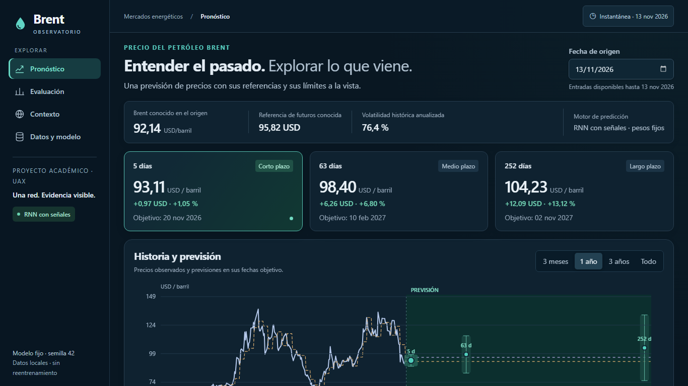

# Predicción del Brent con redes recurrentes

**Caso 2 · UAX · Antonio Aguilera**

Estudio de predicción del precio del petróleo a **5, 63 y 252 días** con RNN,
LSTM y GRU. Incluye datos con fecha de disponibilidad, experimentos conservados,
evaluación temporal, una aplicación HTML con inferencia en el navegador y la
presentación de resultados. El modelo de entrega es una **RNN con señales**.

**[Abrir la aplicación](https://brent-observatorio.onrender.com/)** ·
[Presentación PDF](docs/presentation/Prediccion_Petroleo_RNN_UAX.pdf) ·
[PowerPoint](docs/presentation/Prediccion_Petroleo_RNN_UAX.pptx) ·
[Informe de evaluación](experiments/recovered_fixed_test_20261120/report/INFORME.md)



## Por dónde empezar

| Objetivo | Ruta |
|---|---|
| Probar la aplicación | Web anterior o arranque local de abajo |
| Revisar el modelo y sus errores | [Notebook 05](notebooks/05_test_seis_modelos.ipynb) y [gráficas HTML](experiments/recovered_fixed_test_20261120/report/comparacion.html) |
| Comprobar las cifras guardadas | `python -S -m scripts.verify_release --require-build` después de construir el HTML |
| Repetir el entrenamiento | [Guía de reproducibilidad](docs/REPRODUCIBILIDAD.md) |
| Consultar búsquedas y alternativas | [Índice de resultados](docs/REPRODUCIBILIDAD.md#resultados-conservados), resúmenes de Optuna y comprobación walk-forward |

## Arranque local: aplicación HTML

Requisito: **Python 3.12**. Desde la raíz de una copia del repositorio:

```powershell
python -m scripts.build_app
python -m http.server 8000 --directory app_site/dist
```

Abre **http://localhost:8000**. Este recorrido usa solo la biblioteca estándar
de Python: los datos, pesos y escalas exportados ya están incluidos. No necesita
instalar PyTorch, Node.js, introducir tokens ni entrenar. El comando de construcción
también crea `app_site/dist/standalone.html`, que puede abrirse sin conexión.
La carpeta `dist/` se genera localmente y no se versiona.

## Entorno de análisis y entrada en Streamlit

En **Windows/PowerShell**, el instalador prepara Python 3.12, `.venv`, Poetry,
las dependencias bloqueadas y el HTML. La primera instalación necesita Internet.

```powershell
powershell -NoProfile -ExecutionPolicy Bypass -File .\setup.ps1
.\.venv\Scripts\python.exe -m streamlit run app.py
```

Abre la dirección que muestre Streamlit, normalmente **http://localhost:8501**.
En Linux/macOS o si ya tienes Python y Poetry:

```bash
python -m pip install "poetry==2.5.1"
poetry install --with analysis
poetry run python -m scripts.build_app
poetry run streamlit run app.py
```

`pyproject.toml` declara las dependencias y `poetry.lock` fija sus versiones.
Para los comandos de análisis de esta documentación, usa el Python de `.venv`
en Windows o el prefijo `poetry run` en otros sistemas.

## Estructura del repositorio

| Carpeta o archivo | Contenido |
|---|---|
| [`study/`](docs/REPRODUCIBILIDAD.md#comandos-y-componentes) | Lógica reutilizable: ventanas, señales, redes, entrenamiento, métricas y diagnósticos |
| [`scripts/`](docs/REPRODUCIBILIDAD.md#comandos-y-componentes) | Comandos de datos, experimentación, informes, construcción y verificación |
| [`app_site/`](app_site/) | Interfaz HTML/CSS/JS, motor de inferencia y exportaciones JSON del modelo |
| [`app.py`](app.py) | Entrada mínima para mostrar la aplicación en Streamlit |
| [`config/`](docs/REPRODUCIBILIDAD.md#configuraciones) | Protocolos y selección exacta del modelo de entrega |
| [`data/`](docs/REPRODUCIBILIDAD.md#datos-y-disponibilidad) | Fuentes originales, tablas de disponibilidad y conjuntos de desarrollo congelados |
| [`experiments/`](docs/REPRODUCIBILIDAD.md#resultados-conservados) | Pesos, escalas, curvas, predicciones, métricas e informes por experimento |
| [`notebooks/`](README.md#notebooks) | Análisis ejecutados y comparación visual de resultados |
| [`tests/`](tests/) | Pruebas del tratamiento temporal, entrenamiento, métricas y aplicación |
| [`docs/`](docs/) | Enunciado, reproducción, fuentes y presentación |
| [`model_hub/`](model_hub/rnn-brent-signals/README.md) | Paquete portable del modelo preparado para Hugging Face |
| [`render.yaml`](render.yaml) | Configuración del sitio estático en Render |
| [`setup.ps1`](setup.ps1) | Instalación reproducible del entorno en Windows |

Los nuevos entrenamientos de reproducción se guardan en `runs/reproduction/`,
fuera de los resultados de entrega. Entornos, cachés, logs y compilados están
excluidos mediante `.gitignore`; los datos, checkpoints y manifiestos se conservan.

## Notebooks

| Archivo | Contenido |
|---|---|
| [02 · Partición fija](notebooks/02_particion_fija_2018_2022.ipynb) | Entrenamiento y validación de las tres arquitecturas, niveles/señales y semillas |
| [03 · Regularización](notebooks/03_regularizacion_validacion.ipynb) | Diagnósticos de sobreajuste y comprobaciones temporales de desarrollo |
| [05 · Evaluación histórica](notebooks/05_test_seis_modelos.ipynb) | Curvas y errores 2023–2024 de los seis checkpoints; incluye la RNN elegida |

Los notebooks incluyen salidas guardadas y leen las tablas existentes. Para
ejecutarlos, selecciona el intérprete de `.venv`. La numeración conserva las
referencias de los informes.

## Datos y partición temporal

Las fuentes son **FRED/EIA, ALFRED y Yahoo Finance**. ALFRED permite utilizar
fechas de publicación y revisiones históricas; Yahoo aporta futuros y variables
de mercado. El [diccionario de datos](docs/REPRODUCIBILIDAD.md#datos-y-disponibilidad) distingue precio observado
e información conocida en cada origen. Se arrastra la última información
disponible como entrada; **las etiquetas reales ausentes no se rellenan**.

| Bloque | Uso en el modelo entregado |
|---|---|
| Hasta el 31/12/2017 | Ajuste de pesos y escalas |
| 01/01/2018–31/12/2022 | Validación y elección de la época |
| 01/01/2023–31/12/2024 | Comparación histórica posterior |

Tanto el origen como su objetivo deben pertenecer al bloque correspondiente.
Los horizontes cuentan **días de lunes a viernes, incluidos festivos**, y se
evalúan únicamente objetivos publicados. Por ello cada horizonte tiene un N
distinto. El histórico visible comienza en 2000; las entradas multivariables
completas del experimento empiezan en 2012.

La instantánea de la app termina el **13/11/2026**; el último precio real publicado
incluido es del **11/11/2026**. La app no presenta esta copia como un mercado en directo.

## Modelo y resultados de entrega

[`config/delivery_model.json`](config/delivery_model.json) identifica los pesos
originales utilizados tanto en la web como en la presentación:

| Componente | Configuración |
|---|---|
| Red | Una capa RNN `tanh`, 32 unidades y cabeza lineal de tres salidas |
| Entrada | Ventana de 60 días; 16 señales derivadas de siete variables conocidas |
| Tamaño | 1699 parámetros |
| Entrenamiento | Semilla 42, Adam, learning rate 0,001, lote 128, máximo 40 épocas |
| Regularización y selección | Dropout 0, L2 0, recorte del gradiente a 1; parada con paciencia 10 |
| Checkpoint | Época 17 de 27 ejecutadas; pesos y escalas originales |

La búsqueda incluyó arquitecturas y configuraciones adicionales, regularización,
varias semillas y **112 intentos de Optuna**. Los seis modelos del informe
posterior son un subconjunto recuperado para compararlos con el mismo protocolo;
no representan el total de experimentos.

Resultados de la RNN con señales en 2023–2024:

| Horizonte | N | MAE | MSE | RMSE | R² | RMSE / ingenuo spot | RMSE / futuros |
|---|---:|---:|---:|---:|---:|---:|---:|
| 5 días | 499 | 3,127 | 15,145 | 3,892 | 0,558 | 0,886 | 1,080 |
| 63 días | 441 | 7,592 | 83,473 | 9,136 | −1,274 | 1,000 | 1,073 |
| 252 días | 258 | 7,759 | 89,668 | 9,469 | −2,130 | 1,005 | 1,081 |

MAE y RMSE se expresan en USD/barril; MSE, en sus unidades al cuadrado.
El ingenuo spot conserva el último Brent ya publicado en el origen; la referencia
de futuros conserva el cierre conocido del contrato. **Un ratio menor que 1
indica menor RMSE**, sin equivaler a rentabilidad. Las cifras completas y las
filas de origen/objetivo están en [metrics.csv](experiments/recovered_fixed_test_20261120/metrics.csv)
y [predictions.csv](experiments/recovered_fixed_test_20261120/predictions.csv).

La mejora frente al spot se concentra en 5 días; a 63 y 252 días prácticamente
empata y no supera la referencia de futuros. El R² es negativo en los dos
horizontes largos. La validación muestra deterioro después de la época elegida,
motivo para conservar el checkpoint temprano.

Los horizontes largos se solapan. A 252 días hay **6 objetivos en 2023 y 252 en
2024**; todos permanecen en los CSV y el total. La vista anual de la app exige
30 observaciones y explica los subconjuntos no disponibles. Las bandas del 80 %
son empíricas, calculadas con residuos de validación, sin garantía de cobertura futura.
El periodo 2023–2024 ya fue examinado durante el desarrollo: los resultados
se interpretan como evaluación histórica y no como un nuevo test intacto.

## Comprobar y reproducir

Después de construir el HTML, este comando **no instala paquetes ni modifica archivos**:

```powershell
python -S -m scripts.verify_release --require-build
```

Comprueba hashes de pesos y datos, recalcula las métricas desde los CSV y
contrasta las exportaciones de la app y del paquete portable. Para volver a
entrenar la RNN en una carpeta independiente:

```powershell
.\.venv\Scripts\python.exe -m scripts.reproduce_delivery --plan-only
.\.venv\Scripts\python.exe -m scripts.reproduce_delivery
```

La [guía de reproducibilidad](docs/REPRODUCIBILIDAD.md) explica entradas, salidas,
regeneración de informes, pruebas y presentación. El flujo de GitHub Actions está
preparado para verificar en Windows y Linux, sin lanzar entrenamientos; se
ejecutará al subir los cambios. Las comprobaciones locales se han realizado en Windows.

## Aplicación, actualización y publicación

La web permite consultar pronósticos, comparar predicciones y precios reales,
examinar contexto histórico e importar nuevas observaciones mediante CSV.
La carga actualiza las entradas y pasa por la red existente; **no reentrena**.
Las filas añadidas se guardan en el navegador y pueden descargarse o restaurarse.

La aplicación está publicada en **[Render](https://brent-observatorio.onrender.com/)**.
El paquete del modelo está preparado en `model_hub/rnn-brent-signals`; su
publicación en Hugging Face está pendiente. La [guía de despliegue](docs/deployment/DESPLIEGUE.md)
explica cómo subir sus pesos, escalador, código de inferencia y ficha del modelo.
El PowerPoint, PDF y plantilla están en [`docs/presentation/`](docs/presentation/).

## Documentación y fuentes

[Enunciado original](docs/assignment/ENUNCIADO.pdf) ·
[Resultados conservados](docs/REPRODUCIBILIDAD.md#resultados-conservados) ·
[Fuentes y referencias](docs/FUENTES.md).

Los materiales iniciales proceden del [repositorio de la asignatura](https://github.com/UAX-VCMT-26-27/aa-case-02-oil-price-prediction).
Las fuentes de datos y las referencias metodológicas están reunidas en
`docs/FUENTES.md`; cada fuente conserva sus condiciones de uso. La entrega mantiene
los checkpoints de la partición fija y sus resultados, junto con los resúmenes de
búsqueda necesarios para justificar la configuración. Los pesos intermedios de
campañas anteriores y los informes de revisión no forman parte del recorrido de reproducción.
