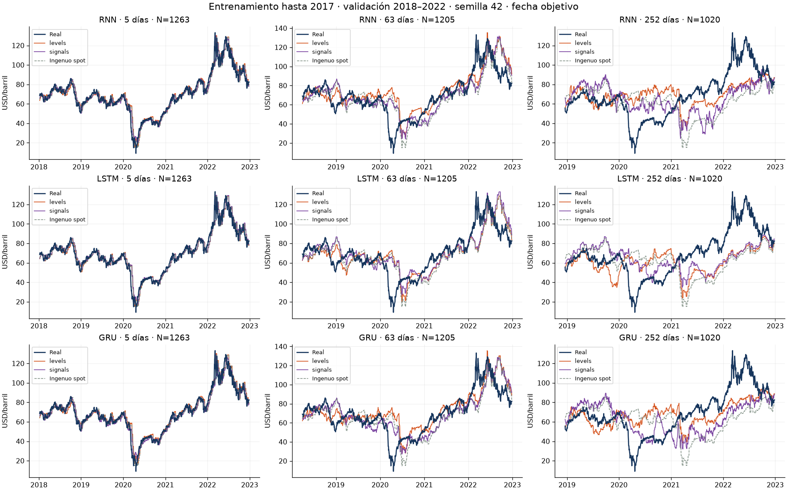
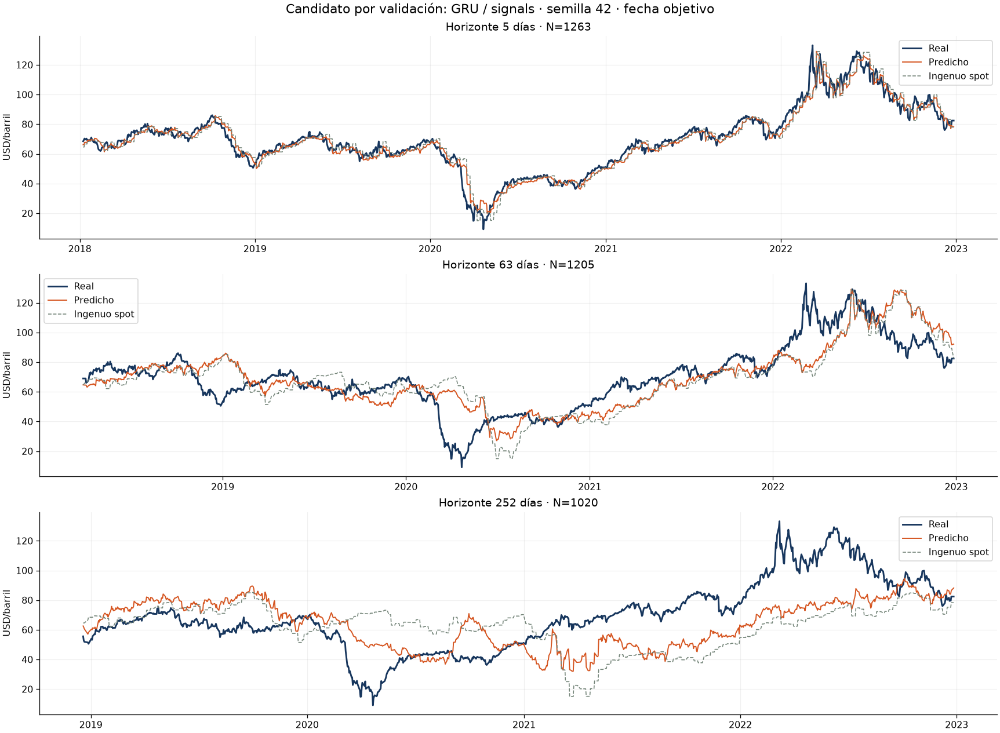
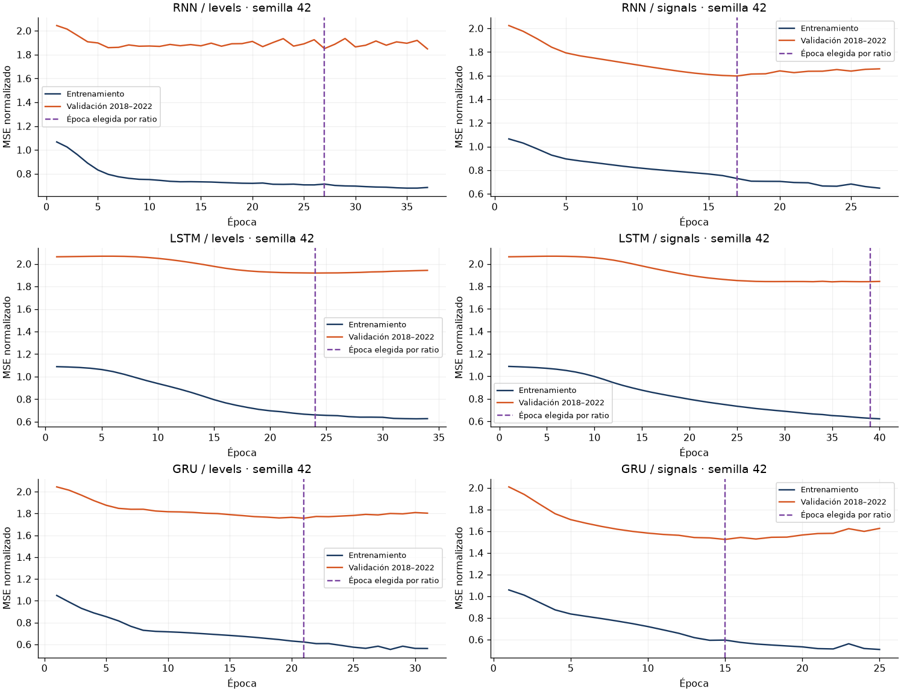

# Entrenamiento fijo hasta 2017 y validación 2018–2022

18 ajustes completados en 257.4 segundos acumulados de entrenamiento en CPU. Un ajuste por arquitectura, variante y semilla; los mismos pesos se usan para todos los años. Máximo 40 épocas, paciencia 10. No se ha ejecutado una nueva búsqueda de Optuna.

Estas métricas pertenecen a la validación usada para seleccionar la época y comparar candidatos; no son resultados de un test independiente. El test 2023–2024 sigue reservado. Las cifras son medias de métricas de tres semillas, no métricas de una predicción promediada.

Entradas disponibles desde 22/03/2012; primer origen con ventana de 60 días: 13/06/2012. Pesos y escalas ajustados solo antes de 2018. Etiquetas de entrenamiento antes de 2018 y de validación antes de 2023, respetando también su publicación. No se rellenan precios objetivo.

## Métricas de validación

| Red | Entradas | Horizonte | N | MAE | MSE | RMSE | R² | Ratio spot | Ratio futuros |
| --- | --- | --- | --- | --- | --- | --- | --- | --- | --- |
| GRU | levels | 5 | 1263 | 3.985 | 33.063 | 5.750 | 0.926 | 1.008 | 1.197 |
| GRU | levels | 63 | 1205 | 10.432 | 234.405 | 15.308 | 0.500 | 0.958 | 1.032 |
| GRU | levels | 252 | 1020 | 15.723 | 372.968 | 19.312 | 0.313 | 0.700 | 0.717 |
| GRU | signals | 5 | 1263 | 3.575 | 24.870 | 4.987 | 0.944 | 0.874 | 1.038 |
| GRU | signals | 63 | 1205 | 10.565 | 211.115 | 14.526 | 0.549 | 0.909 | 0.979 |
| GRU | signals | 252 | 1020 | 17.331 | 437.344 | 20.909 | 0.195 | 0.758 | 0.776 |
| LSTM | levels | 5 | 1263 | 3.989 | 32.312 | 5.684 | 0.928 | 0.997 | 1.183 |
| LSTM | levels | 63 | 1205 | 11.304 | 245.929 | 15.682 | 0.475 | 0.981 | 1.057 |
| LSTM | levels | 252 | 1020 | 20.671 | 607.637 | 24.649 | -0.119 | 0.894 | 0.915 |
| LSTM | signals | 5 | 1263 | 4.016 | 32.703 | 5.719 | 0.927 | 1.003 | 1.190 |
| LSTM | signals | 63 | 1205 | 11.242 | 243.730 | 15.609 | 0.480 | 0.976 | 1.052 |
| LSTM | signals | 252 | 1020 | 19.858 | 582.162 | 23.990 | -0.072 | 0.870 | 0.891 |
| RNN | levels | 5 | 1263 | 3.967 | 32.433 | 5.695 | 0.928 | 0.999 | 1.185 |
| RNN | levels | 63 | 1205 | 10.540 | 237.073 | 15.396 | 0.494 | 0.963 | 1.038 |
| RNN | levels | 252 | 1020 | 17.081 | 446.565 | 21.126 | 0.178 | 0.766 | 0.784 |
| RNN | signals | 5 | 1263 | 3.488 | 24.184 | 4.918 | 0.946 | 0.862 | 1.024 |
| RNN | signals | 63 | 1205 | 10.573 | 214.780 | 14.654 | 0.541 | 0.917 | 0.988 |
| RNN | signals | 252 | 1020 | 19.261 | 523.984 | 22.890 | 0.035 | 0.830 | 0.850 |

MAE y RMSE: USD/barril. MSE: (USD/barril)². Ratio spot/futuros: RMSE del modelo dividido por el de mantener el último spot publicado/cierre de futuros disponible en el origen. No son métricas de rentabilidad ni contratos ajustados al vencimiento de cada horizonte.

## Sobreajuste

La regla diagnóstica detecta señal de sobreajuste en 5 de 18 ajustes: la pérdida de entrenamiento baja y el ratio de validación empeora más del 2% desde la época elegida hasta el final. Se conservan los pesos de la época elegida. Este indicador no demuestra que el sobreajuste esté eliminado; las diferencias de régimen entre 2012–2017 y 2018–2022 también afectan a las pérdidas.

Candidato con menor media de ratios spot: **GRU / signals**. Es una selección de desarrollo; no hay modelo final certificado por test.

## Comparación de todas las redes y horizontes

## Precio real y predicho del candidato con menor ratio medio

## Pérdida de entrenamiento y validación

## Archivos

`validation_by_seed.csv`: detalle por semilla. `annual_by_origin.csv` y `annual_by_target.csv`: desgloses con los mismos pesos, sin reentrenamiento anual. Se señalan los grupos con menos de 20 etiquetas; sí contribuyen al cálculo del bloque completo. `training_diagnostics.csv`: épocas y evolución de pérdidas. Los 18 checkpoints se han recargado y sus predicciones y métricas se han verificado.
