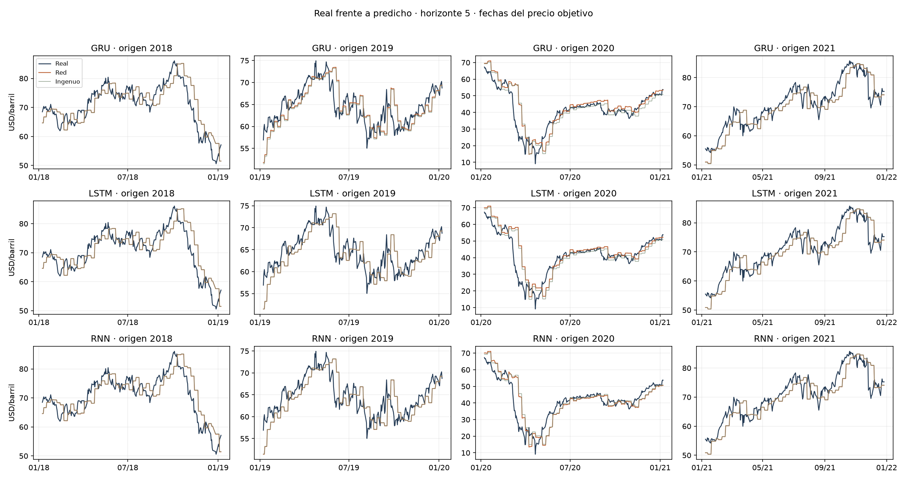
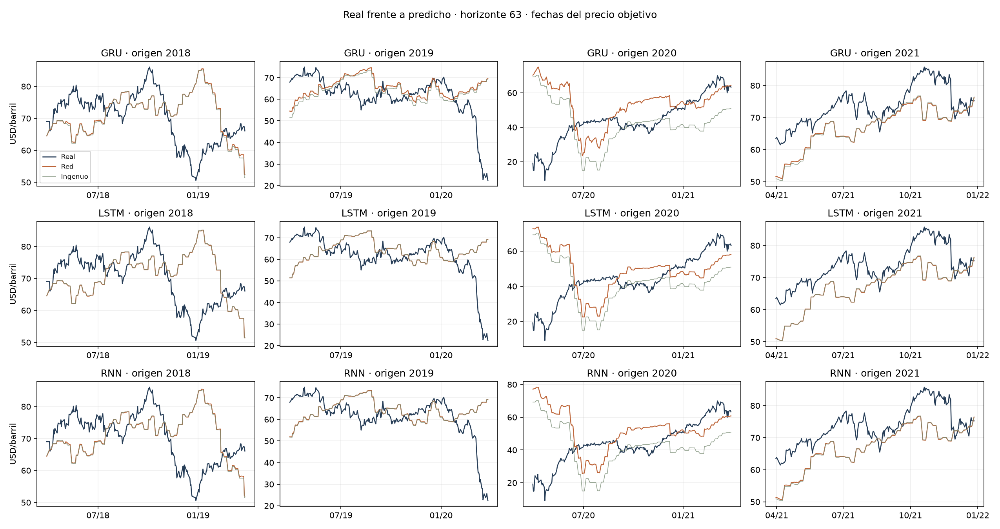
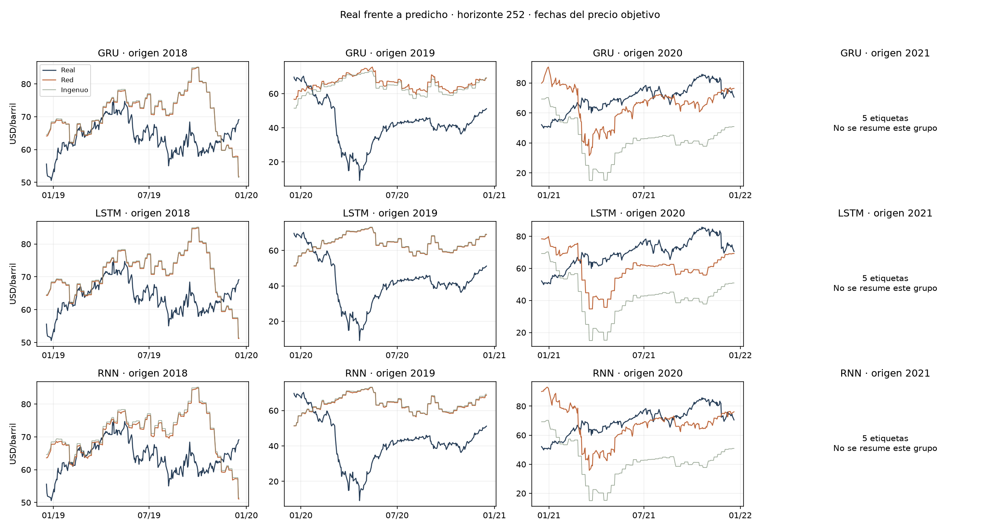
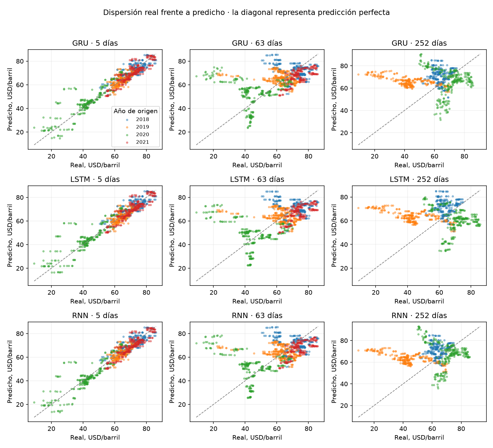

# Evaluación estadística de la validación v2

Informe generado a partir de predicciones guardadas. No se ha reentrenado ni evaluado test o calibración. Se mantienen la selección interna y los grupos evaluables de la ejecución original.

MAE y RMSE se expresan en USD/barril; MSE en (USD/barril)². R² compara el error con predecir la media de los valores reales del grupo: puede ser negativo. Esa media solo define la métrica, no se usa para entrenar ni generar predicciones. R² no es el cociente frente al ingenuo.

| Red | Horizonte | N | MAE | MSE | RMSE | R² | R² ingenuo | RMSE / ingenuo |
|---|---:|---:|---:|---:|---:|---:|---:|---:|
| GRU | 5 | 1011 | 3.32 | 21.81 | 4.67 | 0.897 | 0.895 | 0.988 |
| GRU | 63 | 953 | 9.80 | 198.11 | 14.08 | 0.113 | 0.092 | 0.989 |
| GRU | 252 | 763 | 15.41 | 390.27 | 19.76 | -0.725 | -1.800 | 0.785 |
| LSTM | 5 | 1011 | 3.38 | 23.25 | 4.82 | 0.890 | 0.895 | 1.021 |
| LSTM | 63 | 953 | 10.05 | 196.85 | 14.03 | 0.118 | 0.092 | 0.985 |
| LSTM | 252 | 763 | 15.86 | 379.98 | 19.49 | -0.679 | -1.800 | 0.774 |
| RNN | 5 | 1011 | 3.39 | 21.66 | 4.65 | 0.898 | 0.895 | 0.985 |
| RNN | 63 | 953 | 10.02 | 210.15 | 14.50 | 0.059 | 0.092 | 1.018 |
| RNN | 252 | 763 | 14.74 | 361.51 | 19.01 | -0.597 | -1.800 | 0.755 |

La tabla agrupa los errores de los periodos evaluables; no es la media de ratios por año. R² agrupado puede ocultar diferencias entre periodos: `metrics_by_year.csv` incluye el detalle, también los grupos con pocas etiquetas identificados como no resumibles.

Los paneles usan fechas del objetivo, no del origen. A 252 días, los orígenes de 2019 predicen principalmente precios de 2020. Los extremos de `largest_errors.csv` ayudan a examinar cuándo falla; se seleccionan para diagnóstico, no para ajustar hiperparámetros.

La dependencia entre orígenes solapados limita la interpretación estadística de estas métricas.
