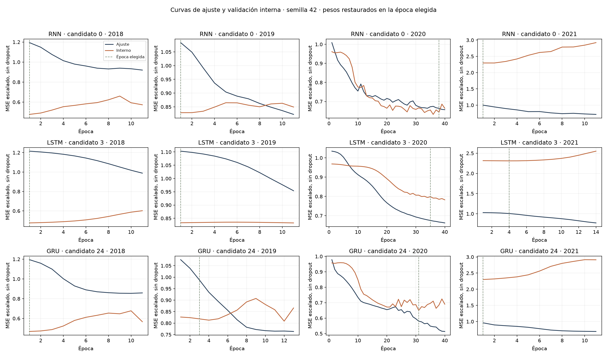
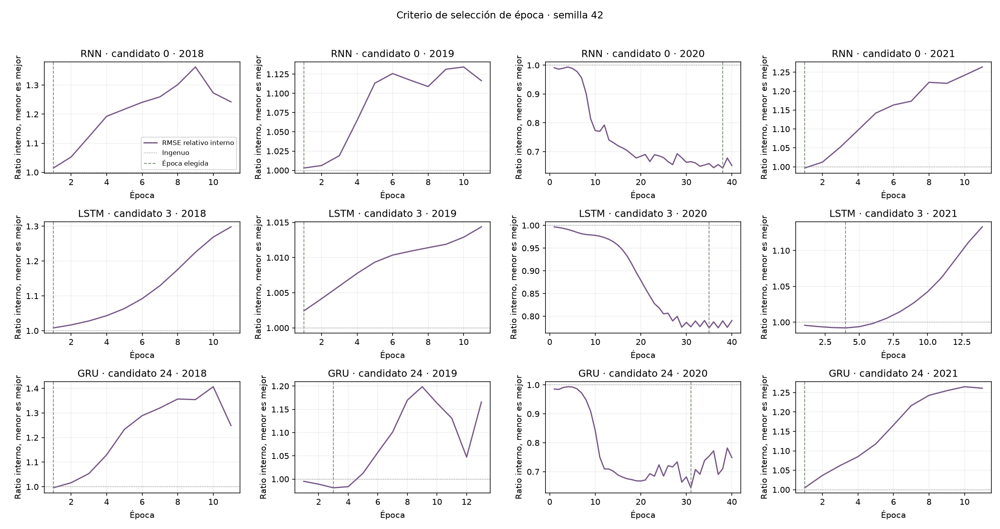
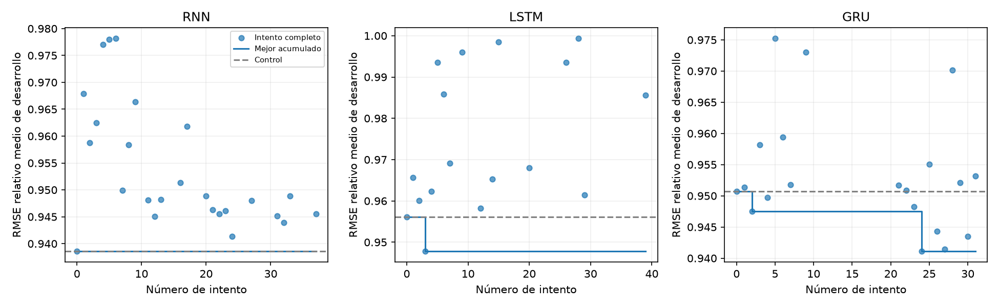

# Optuna en CPU: resultados de desarrollo

Se comparan redes recurrentes con una o dos capas, cabeza densa opcional, agregación temporal, dropout, L2, MSE/Huber, learning rate, batch y reducción de learning rate. Sin convoluciones. Se mantienen ventana 60 y los mismos datos, fronteras y horizontes.

La búsqueda elige hiperparámetros con los años exteriores de desarrollo 2018–2021; cada época se selecciona exclusivamente en un tramo interno anterior al año evaluado. Los resultados de desarrollo intervienen en la selección de candidatos y pueden ser optimistas. Las tres semillas comprueban sensibilidad a la inicialización sobre esos mismos periodos: no son un nuevo test. Calibración 2022–2023 y test 2024+ no se han evaluado.

## Trabajo ejecutado

| Red | Intentos completos | Podados | Fallidos |
|---|---:|---:|---:|
| RNN | 25 | 15 | 0 |
| LSTM | 17 | 23 | 0 |
| GRU | 20 | 12 | 0 |

Ajustes completos de búsqueda: 248. Ajustes nuevos de confirmación: 56. Ajustes parciales podados: 50. Total: 354 ajustes, 5947 épocas. Suma de tiempos medidos de los ajustes: 1.38 horas. Los procesos se han ejecutado en paralelo: esa suma no equivale al tiempo de reloj.

Cada arquitectura tiene un presupuesto de hasta 40 intentos y 30 minutos. El límite se comprueba entre intentos; el que ya está en curso termina. Cada intento completo ajusta cuatro modelos temporales. Los podados solo ajustan parcialmente el primer corte. Sus valores internos no se comparan con las puntuaciones exteriores de los completos.

## Estabilidad de las finalistas

Puntuación = media de ratios RMSE/red ingenua por año, primero dentro de cada horizonte y después entre los tres horizontes. Menor es mejor. Solo se resumen grupos con al menos 20 etiquetas. Se usa una semilla en búsqueda y tres en confirmación; la primera se reutiliza.

| Red | Candidato | Media | Desv. entre semillas | Mínimo | Máximo | Propuesto |
|---|---:|---:|---:|---:|---:|---|
| GRU | 0 | 0.9719 | 0.0278 | 0.9507 | 1.0034 |  |
| GRU | 24 | 0.9515 | 0.0112 | 0.9411 | 0.9634 | Sí |
| GRU | 27 | 0.9551 | 0.0148 | 0.9415 | 0.9709 |  |
| LSTM | 0 | 0.9746 | 0.0217 | 0.9562 | 0.9985 |  |
| LSTM | 3 | 0.9572 | 0.0104 | 0.9478 | 0.9684 | Sí |
| RNN | 0 | 0.9439 | 0.0047 | 0.9386 | 0.9466 | Sí |
| RNN | 24 | 0.9398 | 0.0085 | 0.9306 | 0.9474 |  |

Configuraciones propuestas para seguir investigando:

| Red | Capas × unidades | Cabeza | Resumen | Dropout | LR | Batch | L2 | Pérdida | Scheduler |
|---|---|---:|---|---:|---:|---:|---:|---|---|
| RNN | 1 × 32 | 0 | last | 0.000 | 0.001000 | 128 | 0.00000 | mse | No |
| LSTM | 1 × 32 | 32 | max | 0.117 | 0.000348 | 64 | 0.00100 | mse | No |
| GRU | 1 × 32 | 0 | last | 0.164 | 0.001722 | 128 | 0.00000 | mse | No |

El candidato 0 es el control de una capa de 32 unidades, con el mismo máximo de 40 épocas. La regla se fijó antes de confirmar: mejora media mínima de 0,005 puntos, ganancia en al menos dos semillas y menor media + desviación que el control. Si nadie la cumple se conserva el control. Tres semillas no permiten afirmar significación estadística ni estabilidad en otros regímenes.

## Métricas en unidades originales

Medias de métricas agrupadas por semilla para los candidatos propuestos. MAE/RMSE en USD/barril; MSE en USD²/barril². R² puede ser negativo. El ratio de esta tabla agrupa errores y difiere de la puntuación anterior, que promedia ratios anuales.

| Red | Candidato | Horizonte | MAE | MSE | RMSE | R² | RMSE/ingenuo | RMSE/media móvil |
|---|---:|---:|---:|---:|---:|---:|---:|---:|
| GRU | 24 | 5 | 3.32 | 21.94 | 4.68 | 0.897 | 0.991 | 0.322 |
| GRU | 24 | 63 | 10.08 | 211.90 | 14.55 | 0.051 | 1.022 | 0.800 |
| GRU | 24 | 252 | 15.73 | 408.55 | 20.20 | -0.805 | 0.803 | 0.930 |
| LSTM | 3 | 5 | 3.38 | 23.08 | 4.80 | 0.891 | 1.017 | 0.330 |
| LSTM | 3 | 63 | 10.12 | 198.15 | 14.08 | 0.113 | 0.989 | 0.774 |
| LSTM | 3 | 252 | 16.76 | 416.16 | 20.38 | -0.839 | 0.810 | 0.938 |
| RNN | 0 | 5 | 3.35 | 21.93 | 4.68 | 0.897 | 0.991 | 0.322 |
| RNN | 0 | 63 | 10.04 | 211.10 | 14.53 | 0.055 | 1.020 | 0.799 |
| RNN | 0 | 252 | 15.32 | 375.41 | 19.37 | -0.659 | 0.770 | 0.891 |

## Sobreajuste

Se marca una señal cuando, después de la época elegida, el MSE de ajuste baja y el ratio interno empeora más del 2 %. Es una señal operativa; un error interno mayor que el de ajuste, por sí solo, también puede reflejar un cambio de régimen. Todas las curvas se calculan en modo evaluación, sin dropout, y con la misma escala del objetivo ajustada solo en entrenamiento.

Se observa esa señal en 238 de 304 ajustes completos. Se restauran siempre los pesos de la mejor época interna; no se utilizan los pesos finales deteriorados. `overfit_diagnostics.csv` conserva el detalle de todas las configuraciones completas.

En 15 ajustes la mejor época coincide con el máximo permitido. En esos casos no se ha observado aún una parada por deterioro; aumentar el máximo es una posible prueba posterior, manteniendo la selección interna. No se presupone convergencia.

Comparación de los tres controles prefijados, semilla 42. El control 1 añade capacidad y el 2 combina varias medidas de regularización; al cambiar varias cosas a la vez no se puede atribuir su efecto a un único componente.

| Red | Control | Parámetros | Puntuación | Señales / 4 cortes | Deterioro interno mediano | Segundos |
|---|---:|---:|---:|---:|---:|---:|
| RNN | 0 | 1699 | 0.9386 | 3 | 16.9 % | 29.7 |
| RNN | 1 | 15747 | 0.9679 | 4 | 12.2 % | 91.4 |
| RNN | 2 | 4803 | 0.9587 | 3 | 14.1 % | 66.5 |
| LSTM | 0 | 6499 | 0.9562 | 4 | 21.2 % | 50.5 |
| LSTM | 1 | 56451 | 0.9656 | 3 | 8.7 % | 264.3 |
| LSTM | 2 | 15939 | 0.9601 | 3 | 12.7 % | 102.0 |
| GRU | 0 | 4899 | 0.9507 | 4 | 20.5 % | 55.3 |
| GRU | 1 | 42883 | 0.9513 | 3 | 13.7 % | 269.3 |
| GRU | 2 | 12227 | 0.9475 | 3 | 18.8 % | 119.9 |

El MSE escalado y la media de ratios RMSE ponderan de forma distinta los horizontes y las etiquetas disponibles. La época se elige con el segundo criterio; puede no coincidir con el mínimo del MSE interno. Ambas curvas se muestran por separado.

El dropout recurrente solo actúa con dos capas; además hay dropout explícito antes de la cabeza. L2, Huber, reducción de learning rate y early stopping se prueban, sin suponer que todos mejoren. Los tres controles iniciales se ejecutan sin poda, incluida la referencia sencilla y dos configuraciones de dos capas. La poda de los siguientes se basa en la curva interna del primer corte; puede descartar redes que mejoren más tarde o en otro periodo.

## Archivos para revisar

- `stability.csv` y `scores_by_seed.csv`: sensibilidad a inicialización.
- `all_finalist_metrics.csv`: R², MAE, MSE, RMSE, ratios y épocas por año/horizonte/semilla.
- `paired_yearly_comparison.csv`: periodos donde cada finalista mejora o empeora respecto al control.
- `pooled_by_seed.csv`: métricas agrupadas y comparación con la media móvil de 252 observaciones.
- `overfit_diagnostics.csv`: deterioro interno y pérdidas de ajuste.
- `../confirmation/selection.json`: finalistas y regla congeladas antes de las semillas adicionales.
- [Reales frente a predicciones](../development_candidates/statistical_report/INFORME.md): semilla 42 de los candidatos propuestos, seleccionados durante desarrollo.

Los horizontes se cuentan sobre un calendario de lunes a viernes. Las etiquetas faltantes no se imputan; a 252 días, el grupo 2021 tiene solo cinco etiquetas y queda fuera del resumen. Los errores entre orígenes solapados están correlacionados. Una mejora de RMSE histórico no demuestra rentabilidad operable.
