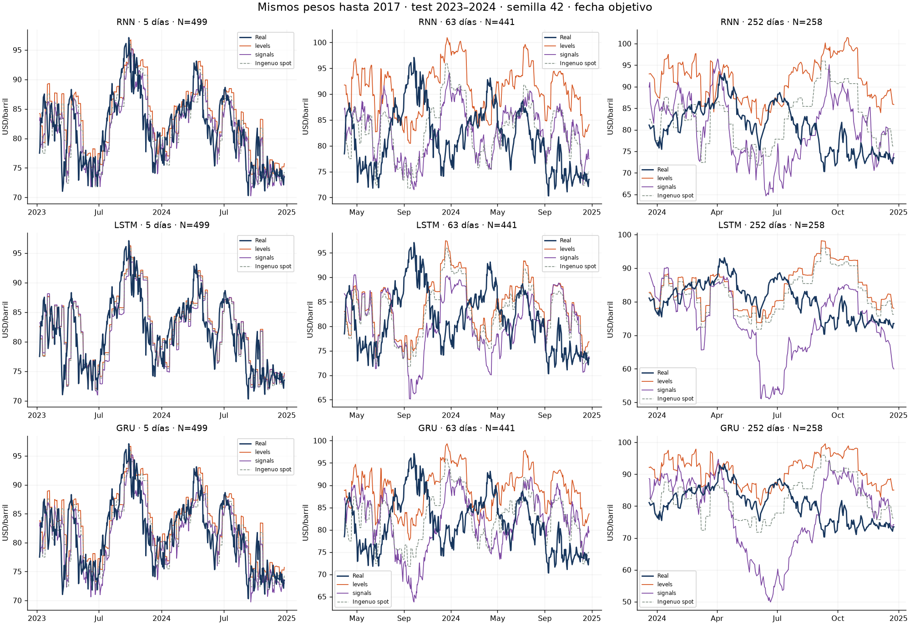
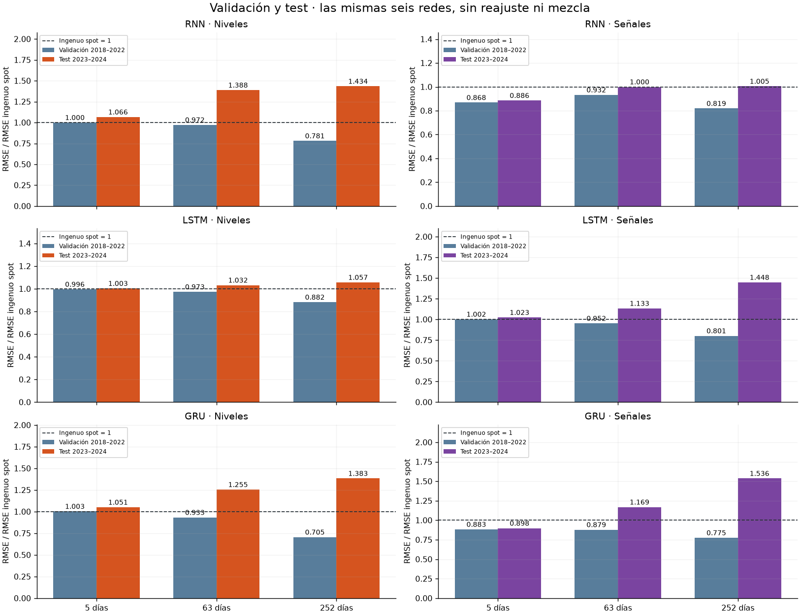
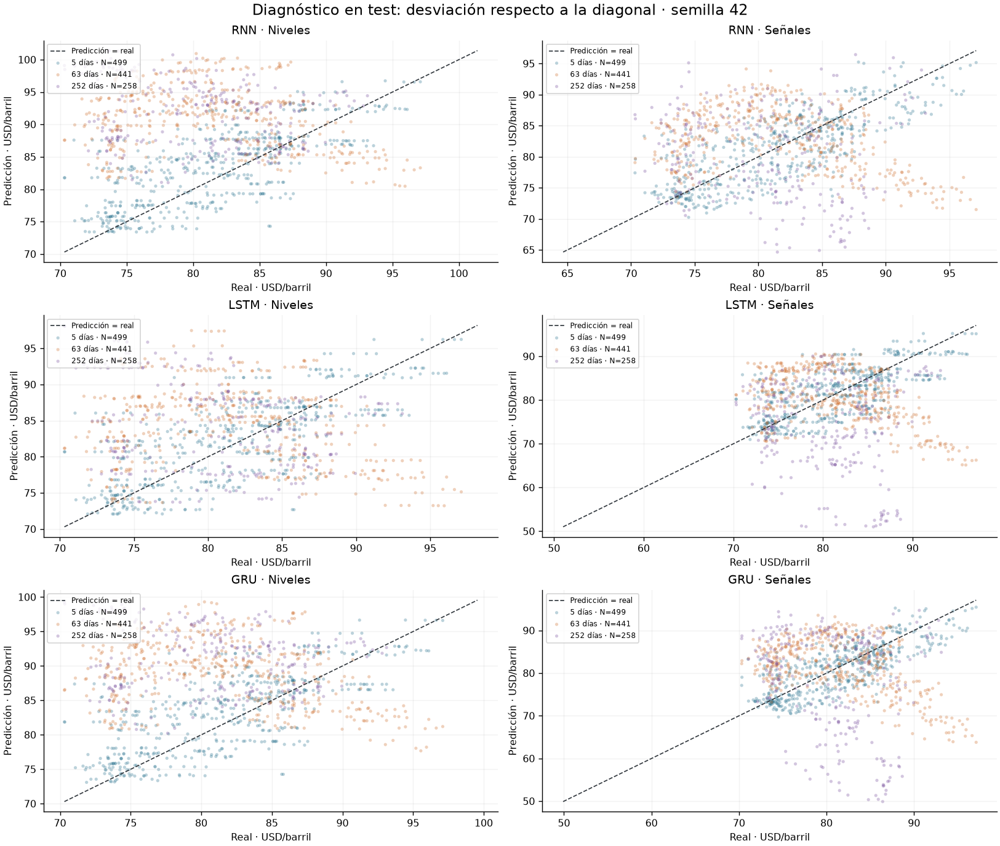

# Test de los seis modelos recuperados · 2023–2024

Se evalúan los seis modelos exactos de la captura: RNN, LSTM y GRU con niveles y señales, semilla 42. Son los pesos y escalas ajustados hasta 2017, sin reentrenamiento, promedio de semillas ni mezcla con el ingenuo. La época de esos pesos se eligió con validación 2018–2022.

Este bloque 2023–2024 ya se había evaluado con otra versión del modelo; aquí se realiza una comparación adicional de seis redes recuperadas.

## Resultados completos

| architecture | variant | horizon | n | mae | mse | rmse | r2 | relative_rmse | relative_rmse_vs_future |
| --- | --- | --- | --- | --- | --- | --- | --- | --- | --- |
| RNN | levels | 5 | 499 | 3.6737 | 21.9499 | 4.6851 | 0.3600 | 1.0661 | 1.3000 |
| RNN | levels | 63 | 441 | 11.1630 | 160.9460 | 12.6864 | -3.3847 | 1.3880 | 1.4905 |
| RNN | levels | 252 | 258 | 11.2217 | 182.6680 | 13.5155 | -5.3758 | 1.4339 | 1.5425 |
| RNN | signals | 5 | 499 | 3.1266 | 15.1453 | 3.8917 | 0.5584 | 0.8856 | 1.0798 |
| RNN | signals | 63 | 441 | 7.5916 | 83.4733 | 9.1364 | -1.2741 | 0.9996 | 1.0734 |
| RNN | signals | 252 | 258 | 7.7594 | 89.6678 | 9.4693 | -2.1297 | 1.0046 | 1.0807 |
| LSTM | levels | 5 | 499 | 3.4558 | 19.4368 | 4.4087 | 0.4333 | 1.0032 | 1.2233 |
| LSTM | levels | 63 | 441 | 7.9972 | 88.9778 | 9.4328 | -1.4241 | 1.0321 | 1.1082 |
| LSTM | levels | 252 | 258 | 7.9687 | 99.2009 | 9.9600 | -2.4625 | 1.0567 | 1.1367 |
| LSTM | signals | 5 | 499 | 3.5331 | 20.2266 | 4.4974 | 0.4103 | 1.0234 | 1.2479 |
| LSTM | signals | 63 | 441 | 8.2209 | 107.2210 | 10.3548 | -1.9211 | 1.1329 | 1.2166 |
| LSTM | signals | 252 | 258 | 10.4422 | 186.1680 | 13.6443 | -5.4979 | 1.4475 | 1.5573 |
| GRU | levels | 5 | 499 | 3.6231 | 21.3226 | 4.6176 | 0.3783 | 1.0508 | 1.2813 |
| GRU | levels | 63 | 441 | 10.0829 | 131.5568 | 11.4698 | -2.5841 | 1.2549 | 1.3476 |
| GRU | levels | 252 | 258 | 10.8691 | 170.0540 | 13.0405 | -4.9355 | 1.3835 | 1.4883 |
| GRU | signals | 5 | 499 | 3.2000 | 15.5634 | 3.9450 | 0.5462 | 0.8977 | 1.0946 |
| GRU | signals | 63 | 441 | 8.5361 | 114.1710 | 10.6851 | -2.1104 | 1.1691 | 1.2554 |
| GRU | signals | 252 | 258 | 11.6655 | 209.7082 | 14.4813 | -6.3196 | 1.5363 | 1.6528 |

Ratio spot = RMSE del modelo / RMSE de mantener el último Brent spot publicado en el origen. Ratio futuros = RMSE del modelo / RMSE de mantener el último cierre de futuros conocido en el origen. Un ratio menor que 1 mejora esa referencia en ese bloque y métrica; no mide rentabilidad. MAE y RMSE se expresan en USD/barril; MSE en (USD/barril)². R² puede ser negativo incluso cuando se mejora al ingenuo.

2/6 redes mejoran el RMSE spot a 5 días; 1/6 redes mejoran el RMSE spot a 63 días; 0/6 redes mejoran el RMSE spot a 252 días. Ninguna de las seis redes mejora al ingenuo de futuros en los tres horizontes. Esta descripción no elige automáticamente un nuevo ganador con el test. Se muestran las seis redes acordadas, aunque alguna empeore la referencia o falle en un horizonte.

## Validación frente a test con los mismos pesos

| architecture | variant | seed | validation_5 | validation_63 | validation_252 | test_5 | test_63 | test_252 |
| --- | --- | --- | --- | --- | --- | --- | --- | --- |
| RNN | levels | 42 | 0.9997 | 0.9721 | 0.7805 | 1.0661 | 1.3880 | 1.4339 |
| RNN | signals | 42 | 0.8682 | 0.9323 | 0.8187 | 0.8856 | 0.9996 | 1.0046 |
| LSTM | levels | 42 | 0.9957 | 0.9731 | 0.8820 | 1.0032 | 1.0321 | 1.0567 |
| LSTM | signals | 42 | 1.0018 | 0.9516 | 0.8012 | 1.0234 | 1.1329 | 1.4475 |
| GRU | levels | 42 | 1.0033 | 0.9333 | 0.7053 | 1.0508 | 1.2549 | 1.3835 |
| GRU | signals | 42 | 0.8832 | 0.8789 | 0.7752 | 0.8977 | 1.1691 | 1.5363 |

Estas cifras son de la semilla 42 de la captura. No son las medias de tres semillas publicadas en otros informes. La validación ayudó a elegir la época; el contraste con test permite observar cuánto se mantiene esa ventaja. Una mejora grande en un horizonte no demuestra sobreajuste por sí sola, ni un ratio cercano a 1 garantiza estabilidad.





## Errores por año objetivo

| architecture | variant | horizon | group | n | rmse | r2 | relative_rmse |
| --- | --- | --- | --- | --- | --- | --- | --- |
| RNN | levels | 5 | target_year_2023 | 247 | 5.2587 | 0.2600 | 1.0627 |
| RNN | levels | 5 | target_year_2024 | 252 | 4.0446 | 0.4415 | 1.0718 |
| RNN | levels | 63 | target_year_2023 | 189 | 12.6308 | -2.6769 | 1.1568 |
| RNN | levels | 63 | target_year_2024 | 252 | 12.7281 | -4.5313 | 1.6891 |
| RNN | levels | 252 | target_year_2023 | 6 | 11.9967 | -95.1093 | 8.5329 |
| RNN | levels | 252 | target_year_2024 | 252 | 13.5496 | -5.2684 | 1.4210 |
| RNN | signals | 5 | target_year_2023 | 247 | 4.3280 | 0.4988 | 0.8746 |
| RNN | signals | 5 | target_year_2024 | 252 | 3.4103 | 0.6029 | 0.9038 |
| RNN | signals | 63 | target_year_2023 | 189 | 11.0577 | -1.8181 | 1.0128 |
| RNN | signals | 63 | target_year_2024 | 252 | 7.3738 | -0.8565 | 0.9786 |
| RNN | signals | 252 | target_year_2023 | 6 | 7.2042 | -33.6589 | 5.1241 |
| RNN | signals | 252 | target_year_2024 | 252 | 9.5167 | -2.0923 | 0.9981 |
| LSTM | levels | 5 | target_year_2023 | 247 | 4.9610 | 0.3414 | 1.0026 |
| LSTM | levels | 5 | target_year_2024 | 252 | 3.7901 | 0.5095 | 1.0044 |
| LSTM | levels | 63 | target_year_2023 | 189 | 10.8247 | -1.7006 | 0.9914 |
| LSTM | levels | 63 | target_year_2024 | 252 | 8.2359 | -1.3159 | 1.0930 |
| LSTM | levels | 252 | target_year_2023 | 6 | 1.6512 | -0.8208 | 1.1745 |
| LSTM | levels | 252 | target_year_2024 | 252 | 10.0746 | -2.4655 | 1.0566 |
| LSTM | signals | 5 | target_year_2023 | 247 | 5.0797 | 0.3095 | 1.0265 |
| LSTM | signals | 5 | target_year_2024 | 252 | 3.8420 | 0.4960 | 1.0182 |
| LSTM | signals | 63 | target_year_2023 | 189 | 12.5694 | -2.6413 | 1.1512 |
| LSTM | signals | 63 | target_year_2024 | 252 | 8.3153 | -1.3608 | 1.1035 |
| LSTM | signals | 252 | target_year_2023 | 6 | 6.1746 | -24.4598 | 4.3918 |
| LSTM | signals | 252 | target_year_2024 | 252 | 13.7729 | -5.4768 | 1.4445 |
| GRU | levels | 5 | target_year_2023 | 247 | 5.1424 | 0.2924 | 1.0392 |
| GRU | levels | 5 | target_year_2024 | 252 | 4.0377 | 0.4434 | 1.0700 |
| GRU | levels | 63 | target_year_2023 | 189 | 11.6633 | -2.1352 | 1.0682 |
| GRU | levels | 63 | target_year_2024 | 252 | 11.3226 | -3.3772 | 1.5026 |
| GRU | levels | 252 | target_year_2023 | 6 | 11.4687 | -86.8363 | 8.1574 |
| GRU | levels | 252 | target_year_2024 | 252 | 13.0756 | -4.8375 | 1.3713 |
| GRU | signals | 5 | target_year_2023 | 247 | 4.4036 | 0.4811 | 0.8899 |
| GRU | signals | 5 | target_year_2024 | 252 | 3.4367 | 0.5967 | 0.9107 |
| GRU | signals | 63 | target_year_2023 | 189 | 13.5976 | -3.2614 | 1.2454 |
| GRU | signals | 63 | target_year_2024 | 252 | 7.8184 | -1.0871 | 1.0376 |
| GRU | signals | 252 | target_year_2023 | 6 | 7.0711 | -32.3899 | 5.0295 |
| GRU | signals | 252 | target_year_2024 | 252 | 14.6120 | -6.2900 | 1.5325 |

El año se refiere al destino de la predicción, no al año del entrenamiento. Las predicciones a 252 días comparten muchos precios de entrada y destinos próximos; 258 pares evaluados por modelo no equivalen a 258 años independientes. No se interpreta este resultado como una prueba en múltiples ciclos económicos.

## Volatilidad conocida en el origen

| architecture | variant | horizon | group | n | rmse | r2 | relative_rmse |
| --- | --- | --- | --- | --- | --- | --- | --- |
| RNN | levels | 5 | origin_high_volatility | 26 | 2.8973 | 0.7387 | 1.1187 |
| RNN | levels | 5 | origin_usual | 473 | 4.7639 | 0.3296 | 1.0651 |
| RNN | levels | 63 | origin_high_volatility | 11 | 14.1454 | -52.2605 | 1.7352 |
| RNN | levels | 63 | origin_usual | 430 | 12.6469 | -3.2949 | 1.3801 |
| RNN | levels | 252 | origin_high_volatility | 9 | 5.3829 | -3.0200 | 1.7508 |
| RNN | levels | 252 | origin_usual | 249 | 13.7194 | -5.8430 | 1.4326 |
| RNN | signals | 5 | origin_high_volatility | 26 | 2.7054 | 0.7722 | 1.0446 |
| RNN | signals | 5 | origin_usual | 473 | 3.9466 | 0.5399 | 0.8824 |
| RNN | signals | 63 | origin_high_volatility | 11 | 11.6650 | -35.2194 | 1.4310 |
| RNN | signals | 63 | origin_usual | 430 | 9.0624 | -1.2053 | 0.9890 |
| RNN | signals | 252 | origin_high_volatility | 9 | 6.2707 | -4.4552 | 2.0396 |
| RNN | signals | 252 | origin_usual | 249 | 9.5649 | -2.3261 | 0.9987 |
| LSTM | levels | 5 | origin_high_volatility | 26 | 2.6020 | 0.7893 | 1.0047 |
| LSTM | levels | 5 | origin_usual | 473 | 4.4870 | 0.4053 | 1.0032 |
| LSTM | levels | 63 | origin_high_volatility | 11 | 9.5209 | -23.1285 | 1.1679 |
| LSTM | levels | 63 | origin_usual | 430 | 9.4305 | -1.3881 | 1.0291 |
| LSTM | levels | 252 | origin_high_volatility | 9 | 2.6997 | -0.0112 | 0.8781 |
| LSTM | levels | 252 | origin_usual | 249 | 10.1254 | -2.7273 | 1.0573 |
| LSTM | signals | 5 | origin_high_volatility | 26 | 2.6284 | 0.7850 | 1.0148 |
| LSTM | signals | 5 | origin_usual | 473 | 4.5781 | 0.3809 | 1.0236 |
| LSTM | signals | 63 | origin_high_volatility | 11 | 9.2277 | -21.6654 | 1.1320 |
| LSTM | signals | 63 | origin_usual | 430 | 10.3820 | -1.8943 | 1.1329 |
| LSTM | signals | 252 | origin_high_volatility | 9 | 3.4945 | -0.6942 | 1.1366 |
| LSTM | signals | 252 | origin_usual | 249 | 13.8728 | -5.9969 | 1.4486 |
| GRU | levels | 5 | origin_high_volatility | 26 | 2.8357 | 0.7497 | 1.0949 |
| GRU | levels | 5 | origin_usual | 473 | 4.6960 | 0.3486 | 1.0499 |
| GRU | levels | 63 | origin_high_volatility | 11 | 12.6820 | -41.8107 | 1.5557 |
| GRU | levels | 63 | origin_usual | 430 | 11.4371 | -2.5125 | 1.2481 |
| GRU | levels | 252 | origin_high_volatility | 9 | 6.3897 | -4.6643 | 2.0783 |
| GRU | levels | 252 | origin_usual | 249 | 13.2184 | -5.3523 | 1.3802 |
| GRU | signals | 5 | origin_high_volatility | 26 | 2.6587 | 0.7800 | 1.0266 |
| GRU | signals | 5 | origin_usual | 473 | 4.0038 | 0.5265 | 0.8952 |
| GRU | signals | 63 | origin_high_volatility | 11 | 9.8998 | -25.0872 | 1.2144 |
| GRU | signals | 63 | origin_usual | 430 | 10.7044 | -2.0769 | 1.1681 |
| GRU | signals | 252 | origin_high_volatility | 9 | 3.9876 | -1.2060 | 1.2970 |
| GRU | signals | 252 | origin_usual | 249 | 14.7212 | -6.8788 | 1.5371 |

La clasificación utiliza la desviación de cambios logarítmicos del Brent conocido en los últimos 21 días de lunes a viernes y un umbral del percentil 90 estimado antes de 2018. Un origen de volatilidad habitual puede sufrir un shock posteriormente. No se eliminan pandemias, guerras ni errores extremos de las métricas globales. Los grupos pequeños requieren especial cautela.



## Bandas empíricas y cobertura observada

| architecture | variant | horizon | n | interval_coverage | interval_mean_width |
| --- | --- | --- | --- | --- | --- |
| RNN | levels | 5 | 499 | 0.8357 | 12.6261 |
| RNN | levels | 63 | 441 | 0.6825 | 29.3893 |
| RNN | levels | 252 | 258 | 1.0000 | 60.1439 |
| RNN | signals | 5 | 499 | 0.8056 | 10.2275 |
| RNN | signals | 63 | 441 | 0.9433 | 32.7709 |
| RNN | signals | 252 | 258 | 1.0000 | 57.7197 |
| LSTM | levels | 5 | 499 | 0.8437 | 12.3823 |
| LSTM | levels | 63 | 441 | 0.9206 | 32.4565 |
| LSTM | levels | 252 | 258 | 1.0000 | 64.7359 |
| LSTM | signals | 5 | 499 | 0.8156 | 12.1450 |
| LSTM | signals | 63 | 441 | 0.8980 | 31.4507 |
| LSTM | signals | 252 | 258 | 0.9225 | 59.0376 |
| GRU | levels | 5 | 499 | 0.8497 | 12.7236 |
| GRU | levels | 63 | 441 | 0.7234 | 28.1389 |
| GRU | levels | 252 | 258 | 0.9806 | 52.0295 |
| GRU | signals | 5 | 499 | 0.7856 | 10.2276 |
| GRU | signals | 63 | 441 | 0.9025 | 31.4875 |
| GRU | signals | 252 | 258 | 0.9186 | 55.8370 |

Las bandas simétricas nominales del 80 % utilizan, por red y horizonte, el cuantil 80 % de los errores absolutos guardados en validación. Esa validación también intervino en la selección de la época; sus muestras se solapan. Son bandas empíricas, sin garantía conformal ni garantía de cobertura futura. No se ajusta su amplitud con el test.

`interval_coverage` es la fracción observada dentro de la banda; `interval_mean_width` es su anchura media en USD/barril. Una banda muy amplia puede cubrir casi todos los puntos y seguir siendo poco útil.

## Fechas y etiquetas disponibles

| horizon | test_origin_days | targets_inside_test_calendar | n | outside_target_calendar | missing_or_unpublished_target |
| --- | --- | --- | --- | --- | --- |
| 5 | 522.0000 | 517.0000 | 499 | 5.0000 | 18.0000 |
| 63 | 522.0000 | 459.0000 | 441 | 63.0000 | 18.0000 |
| 252 | 522.0000 | 270.0000 | 258 | 252.0000 | 12.0000 |

Los horizontes 5, 63 y 252 cuentan días de lunes a viernes e incluyen festivos. Cada punto se representa en su fecha objetivo y utiliza una ventana que termina en su origen. Se conservan solo etiquetas reales válidas y publicadas antes del cierre 2025-01-01: no se rellenan precios objetivo ni se añaden datos de 2025 para completar el horizonte anual. Por eso el número de pares disminuye con el horizonte; los primeros destinos a 252 días están cerca de finales de 2023 y la mayor parte cae en 2024.

Las nuevas observaciones actualizan la ventana de entrada de la red manteniendo sus pesos y escalas. Incorporar un dato no implica reentrenar, de acuerdo con la recomendación del profesor.

## Pesos recuperados y selección original

| architecture | variant | seed | selected_epoch | epochs_run | parameters | overfit_signal |
| --- | --- | --- | --- | --- | --- | --- |
| RNN | levels | 42 | 27 | 37 | 1699.0000 | False |
| RNN | signals | 42 | 17 | 27 | 1699.0000 | True |
| LSTM | levels | 42 | 24 | 34 | 7555.0000 | False |
| LSTM | signals | 42 | 39 | 40 | 7555.0000 | False |
| GRU | levels | 42 | 21 | 31 | 4899.0000 | False |
| GRU | signals | 42 | 15 | 25 | 4899.0000 | True |

Los diagnósticos anteriores corresponden al ajuste original. Una señal de sobreajuste es un aviso metodológico, no una declaración de que todos sus pronósticos sean incorrectos. La comparación usa los checkpoints de la época elegida, no los de la última época. Los seis checkpoints se recargaron y sus predicciones de validación se contrastaron con los archivos originales antes del test; el detalle está en `../replay.json`.

## Archivos y reproducción

```powershell
python -m scripts.evaluate_recovered_test
python -m scripts.report_recovered_test
```

La evaluación reutiliza los resultados completados y verifica su manifiesto. El generador de este informe solo lee salidas guardadas: no entrena, cambia pesos, mezcla modelos ni recalcula métricas de evaluación. El plan identifica los seis checkpoints, sus escalas, configuraciones y amplitudes de bandas. Este informe no modifica el modelo final anterior.

- `../plan.json`: plan e identidad de las seis redes.
- `../replay.json`: contraste con la validación guardada.
- `../predictions.csv`: predicciones, etiquetas y bandas.
- `../metrics.csv`: métricas globales, por año y por régimen.
- `comparison_wide.csv`: validación y test unidos por red y horizonte.
- `ratios_validation_test.csv`: tabla compacta de ratios.
- `comparacion.html`: tablas y gráficas visibles en navegador.
- `../../../notebooks/05_test_seis_modelos.ipynb`: notebook con salidas estáticas.

Una decisión posterior basada en estas cifras debe describirse como selección después de observar el test. No se presenta la mejor fila retrospectiva como una validación nueva e independiente, ni se fuerza el resultado hacia una franja numérica concreta.
