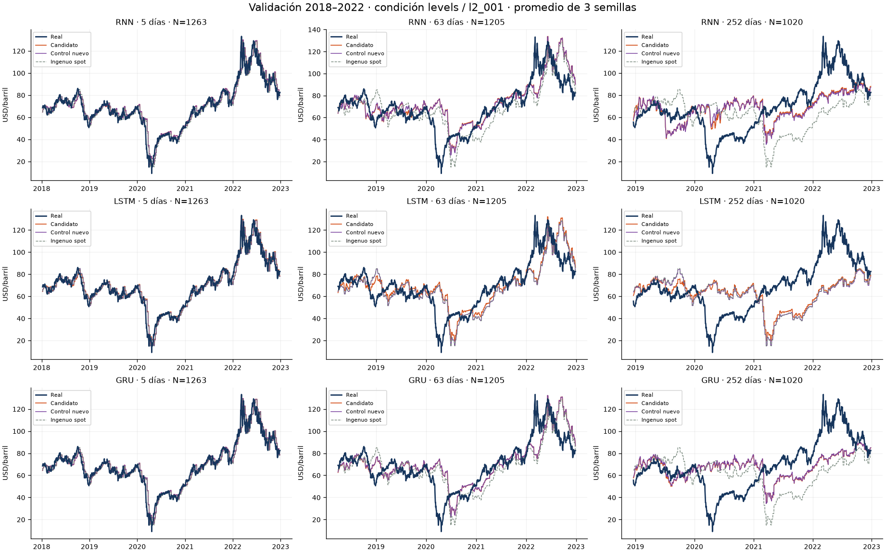
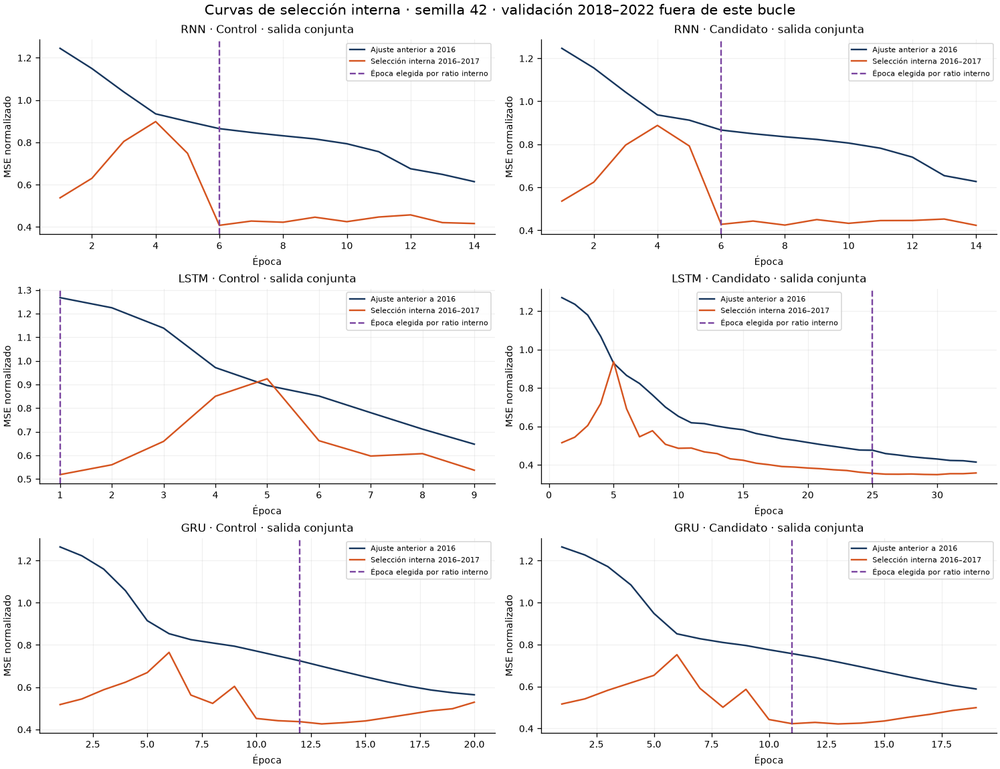
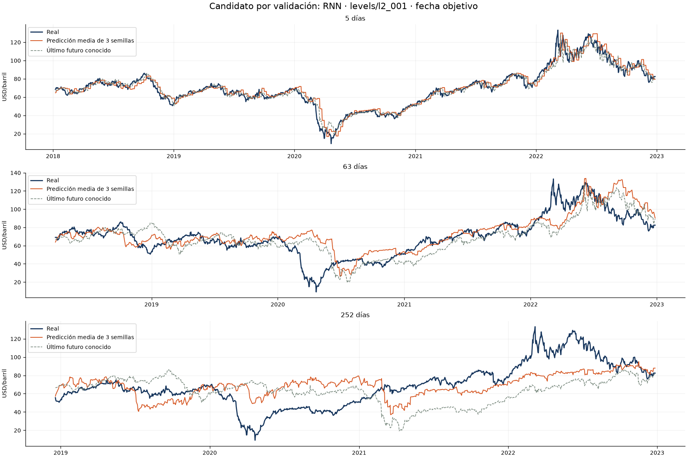

# Regularización y evaluación con selección interna separada

105 trabajos completados; 228 ajustes neuronales incluyendo selección interna y reentrenamiento; 114 checkpoints finales comprobados. Tiempo acumulado de trabajos: 18.8 minutos. Dos procesos CPU, un hilo por proceso. Los trabajos por horizonte tienen tres ramas.

Para el bloque fijo, la época se elige con ajuste anterior a 2016 y selección interna 2016–2017. Después se inicializa otra red y se ajusta todo el histórico anterior a 2018 durante esas épocas. La validación 2018–2022 solo se evalúa con los pesos ya fijados. Sigue interviniendo al comparar configuraciones, por lo que no es un test independiente. El test 2023–2024 permanece reservado.

Criterio fijado: media de ratios RMSE/spot por año objetivo elegible, después por horizonte, semilla y arquitectura. Diferencias menores de 0,005 favorecen menos ramas y parámetros. La condición elegida comparte entradas, ventana y configuración entre las tres celdas. Las métricas de la tabla son medias de métricas individuales; las figuras usan el promedio real de predicciones.

Condición seleccionada: **levels / l2_001**. Arquitectura con menor criterio dentro de esa condición: **RNN**. Es un candidato de desarrollo.

## Confirmación con tres semillas

| variant | trial | architecture | score | seed_std | parameters |
| --- | --- | --- | --- | --- | --- |
| levels | control | GRU | 0.908 | 0.076 | 4899.000 |
| levels | control | LSTM | 0.995 | 0.001 | 6499.000 |
| levels | control | RNN | 0.877 | 0.015 | 1699.000 |
| levels | l2_001 | GRU | 0.908 | 0.075 | 4899.000 |
| levels | l2_001 | LSTM | 0.970 | 0.044 | 6499.000 |
| levels | l2_001 | RNN | 0.863 | 0.013 | 1699.000 |
| levels | window20 | GRU | 0.909 | 0.075 | 4899.000 |
| levels | window20 | LSTM | 0.954 | 0.074 | 6499.000 |
| levels | window20 | RNN | 0.869 | 0.016 | 1699.000 |
| signals | control | GRU | 0.949 | 0.064 | 4899.000 |
| signals | control | LSTM | 0.994 | 0.002 | 6499.000 |
| signals | control | RNN | 0.986 | 0.002 | 1699.000 |

## Métricas de la condición seleccionada

| Red | Horizonte | N | MAE | MSE | RMSE | R² | DE RMSE | Ratio spot agrupado | Ratio futuros agrupado | Ratio spot por años |
| --- | --- | --- | --- | --- | --- | --- | --- | --- | --- | --- |
| GRU | 5 | 1263 | 3.999 | 32.656 | 5.714 | 0.927 | 0.022 | 1.002 | 1.189 | 0.993 |
| GRU | 63 | 1205 | 10.860 | 240.498 | 15.505 | 0.487 | 0.345 | 0.970 | 1.046 | 0.871 |
| GRU | 252 | 1020 | 19.071 | 558.264 | 23.438 | -0.028 | 3.663 | 0.850 | 0.870 | 0.860 |
| LSTM | 5 | 1263 | 4.075 | 33.403 | 5.778 | 0.925 | 0.135 | 1.013 | 1.203 | 1.011 |
| LSTM | 63 | 1205 | 11.465 | 255.364 | 15.980 | 0.455 | 0.062 | 1.000 | 1.078 | 0.951 |
| LSTM | 252 | 1020 | 22.056 | 707.119 | 26.552 | -0.302 | 1.778 | 0.963 | 0.986 | 0.948 |
| RNN | 5 | 1263 | 3.983 | 33.204 | 5.762 | 0.926 | 0.040 | 1.010 | 1.199 | 0.994 |
| RNN | 63 | 1205 | 10.274 | 234.725 | 15.318 | 0.499 | 0.360 | 0.958 | 1.033 | 0.806 |
| RNN | 252 | 1020 | 16.934 | 434.300 | 20.823 | 0.200 | 1.034 | 0.755 | 0.773 | 0.787 |

MAE y RMSE en USD/barril; MSE en (USD/barril)². El ratio agrupado y la media de ratios por años no son la misma agregación. La selección usa la segunda, sin cambiar de criterio tras ver resultados.

## Sobreajuste

Señal interna de deterioro superior al 2% mientras baja la pérdida de ajuste: 9/9 ramas del candidato y 8/9 del control. Es un diagnóstico heurístico de la selección interna; no demuestra ausencia de sobreajuste ni mide por sí solo la calidad del modelo reentrenado. Las curvas corresponden a la selección, no a evaluar 2018–2022 en cada época. La línea vertical minimiza el ratio RMSE/spot interno, que puede elegir una época distinta del mínimo del MSE normalizado dibujado; son agregaciones diferentes.

## Comprobación walk-forward

| variant | trial | architecture | relative_rmse |
| --- | --- | --- | --- |
| levels | control | GRU | 0.813 |
| levels | control | LSTM | 0.909 |
| levels | control | RNN | 0.869 |
| levels | l2_001 | GRU | 0.820 |
| levels | l2_001 | LSTM | 0.872 |
| levels | l2_001 | RNN | 0.819 |
| signals | control | GRU | 0.971 |
| signals | control | LSTM | 0.969 |
| signals | control | RNN | 0.968 |

Bloques: ajuste hasta 2017 y evaluación 2018–2019; ajuste hasta 2019 y evaluación 2020–2022. Cada corte selecciona épocas dentro de su pasado y reentrena con su histórico completo. El candidato y los controles se comprueban con la misma semilla 42; estos resultados no cambian la condición elegida. El control adicional con las mismas entradas de niveles es un diagnóstico emparejado posterior a la selección, se registra por separado y no interviene en volver a elegir al candidato.

## Referencia Ridge

| horizon | n | mae | rmse | r2 | relative_rmse | relative_rmse_vs_future |
| --- | --- | --- | --- | --- | --- | --- |
| 5 | 1263 | 4.000 | 5.681 | 0.928 | 0.996 | 1.182 |
| 63 | 1205 | 10.499 | 15.061 | 0.516 | 0.942 | 1.016 |
| 252 | 1020 | 14.451 | 19.391 | 0.308 | 0.703 | 0.720 |

Ridge usa el vector de entradas del último día; alfa 100/1000 se elige en el tramo interno, después se reajusta con entrenamiento completo. No es una búsqueda exhaustiva del mejor modelo lineal.

## Límites y pendientes

El panel estricto mantiene la cobertura de 2012 en adelante; esta campaña no inventa fechas de publicación anteriores a la cobertura de ALFRED ni rellena precios objetivo. No se amplía aquí hasta 2000. Los cortes walk-forward son una comprobación retrospectiva de desarrollo sobre años ya usados para comparar candidatos, no otra muestra independiente. La predicción de 252 días tiene ventanas fuertemente solapadas. Los intervalos de predicción continúan pendientes de calibración.

## Curvas reales y predichas: candidato y control

## Curvas para detectar sobreajuste durante la selección interna

## Detalle del candidato frente a precios reales y futuros conocidos

